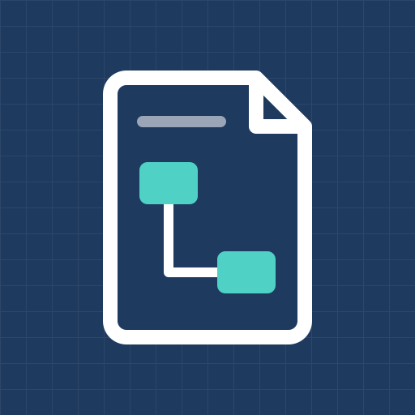

# reference-apps

  

**Implementation-neutral specifications for small, realistic applications.**

Each specification describes a familiar business domain: its data model, its rules, its sample data and the scenarios to verify. There is no code. Anyone can implement a specification, in any stack and any form: a backend API, a frontend, a full-stack app, a CLI, a test suite, or a side-by-side comparison of frameworks.

The domains are simple enough to understand without explanation, and rich enough to exercise what real projects need: one-to-many and many-to-many relationships, hierarchies, cascading and restricted deletes, soft deletes, state changes and validation rules, but also workflows, permissions and audit trails.

## Specifications

| Specification | Domain | What it exercises |
|---|---|---|
| [course-platform-spec](https://github.com/reference-apps/course-platform-spec) | Online course platform (Udemy-style) | Base type with exclusive subtypes, `Course` → `Module` → `Lesson` hierarchy, rich join table (enrollments), soft delete, draft/published states |
| [expense-approval-spec](https://github.com/reference-apps/expense-approval-spec) | Expense claims with manager and finance approval | Workflow, roles and audit: claim state machine, approval chain routed by amount and org chart, separation of duties, visibility rules, audit trail |

More specifications will follow.

## What a specification contains

- **Data model:** an ER diagram with a description of each entity.
- **Requirements:** numbered rules per entity or area (for example `ENR-04` or `APR-02`), written with MUST / SHOULD / MAY.
- **Sample data:** a consistent data set with enough records to try every rule.
- **Scenarios:** concrete cases to verify, such as a delete that is blocked, one that cascades, a record that is archived instead of removed, or an approval refused because the approver is the claimant.

A specification says *what* must hold, never *how*. Whether a rule is enforced by a database, a service layer, a form or an API response is the implementation's choice.

## Implementing a specification

1. Pick a specification and build it in the stack and form you like.
2. Host the implementation in your own repository.
3. In your README, link to the specification and list the requirement IDs you cover.
4. Open an issue on the specification repository to get your implementation listed.

## Contributing

Issues and pull requests on the specification repositories are welcome: to clarify a requirement, fix inconsistent sample data, add a scenario, or propose a new domain.

Source on GitHub: [github.com/reference-apps](https://github.com/reference-apps)
